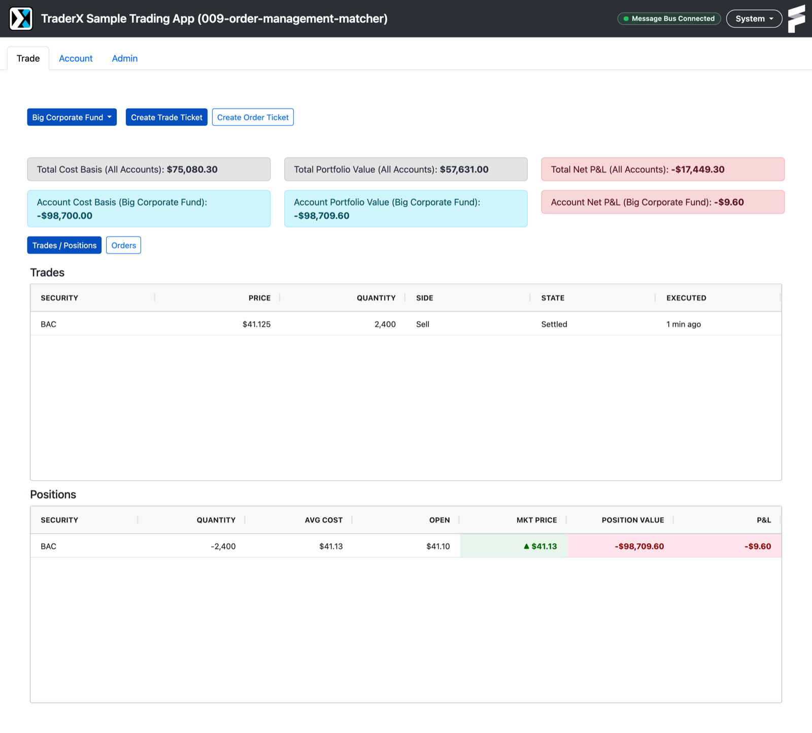
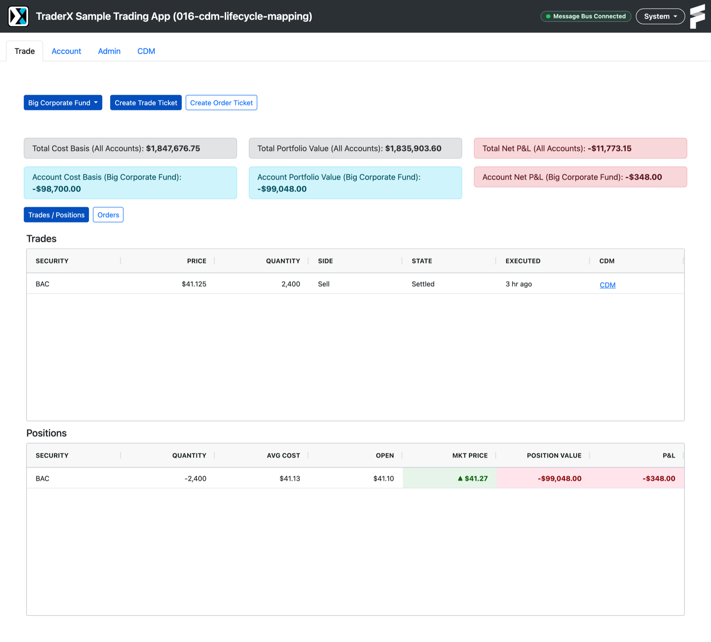
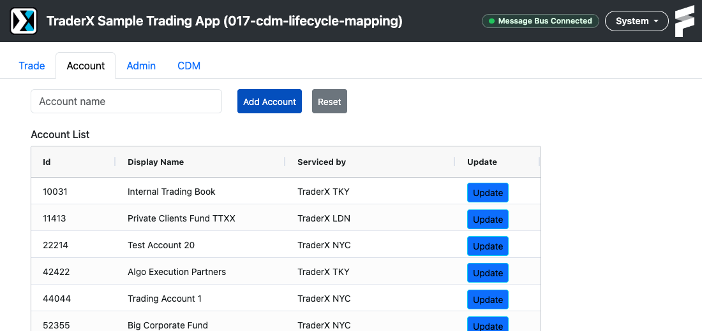
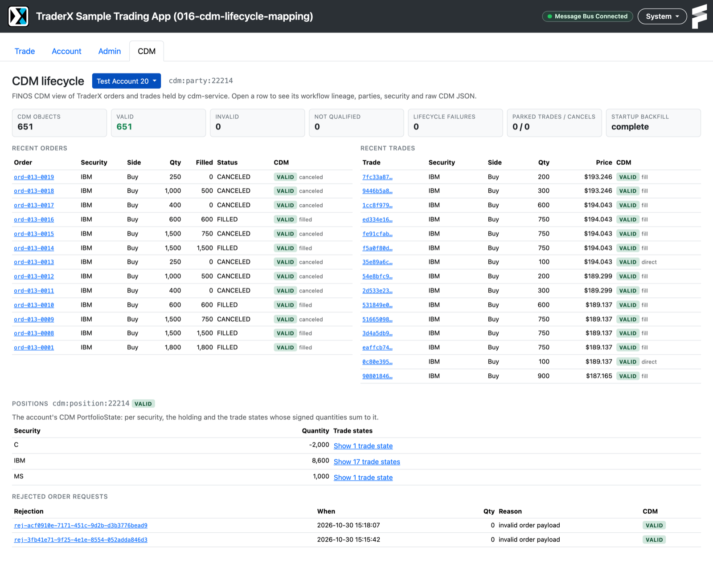
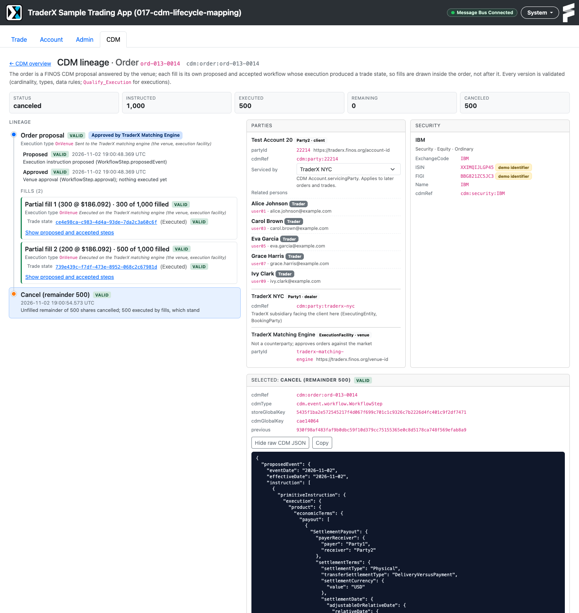
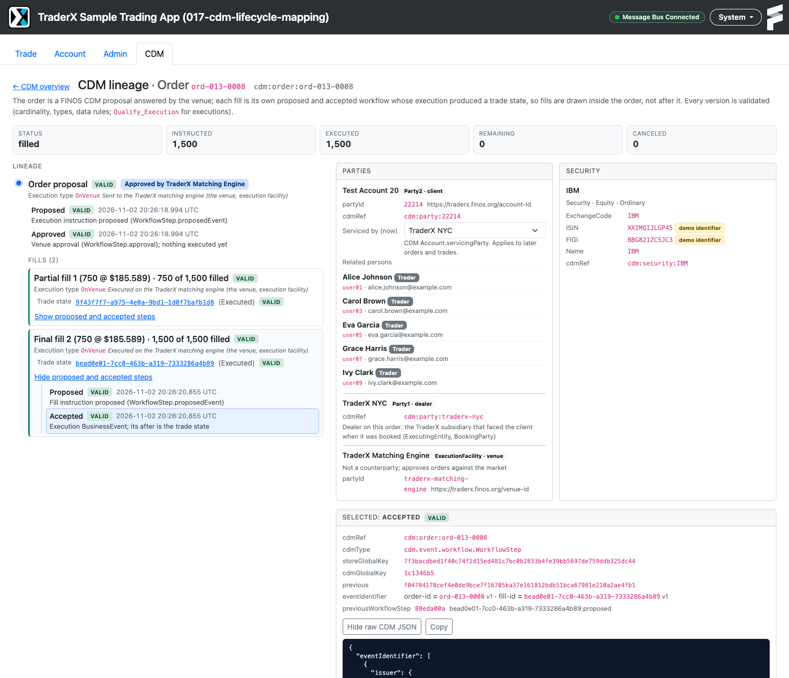
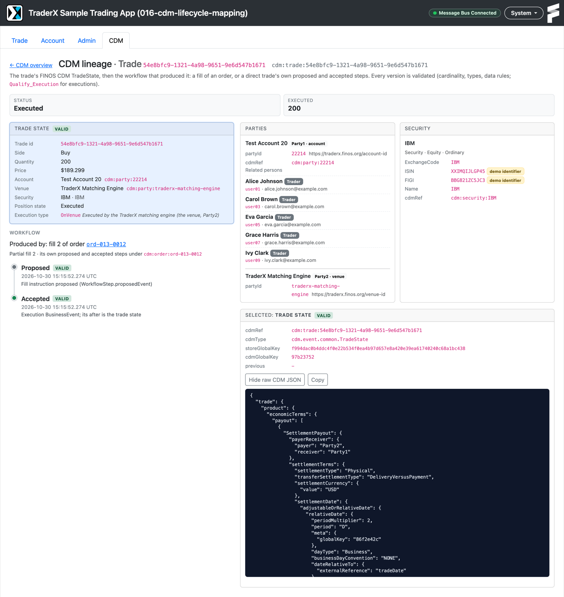

# Feature Pack 017: CDM Lifecycle, Party and Security Model

 

Status: Implemented
Track: `functional`
Lineage role: `optional`
Previous state: `009-order-management-matcher`

This pack puts the [FINOS Common Domain Model](https://cdm.finos.org) (CDM 7.8.0, `cdm-java`)
underneath TraderX, in answer to [finos/traderX#379](https://github.com/finos/traderX/issues/379).

**It demonstrates a path for phased CDM adoption.** An existing trading system rarely gets rebuilt on
a new domain model. 017 shows how it can adopt CDM without that: CDM becomes the system of record for
parties, people and securities, with the existing APIs kept as projections, while orders and trades
keep their 009 operational model and gain a CDM lifecycle built asynchronously from their events. The
trading path does not change, and a validated CDM record of the lifecycle builds up over time. 017 is
also a base for further states with more comprehensive use of CDM, such as other products or other
lifecycles; see [Phased CDM adoption](contracts/cdm-mapping.md#13-phased-cdm-adoption). The
learning guide for this chapter is [`learning-contract.json`](learning-contract.json), rendered on the
docs site as the state 017 learning guide.

- **Parties, persons and securities are CDM records.** A new `cdm-service` owns them as CDM `Party`,
  `NaturalPerson` and `Security` objects. account-service, people-service and reference-data keep
  their 009 shapes, served as projections.
- **A dealer trading with its clients.** Each TraderX account is a client. One of three TraderX
  group subsidiaries (NYC, LDN, TKY) services it and is the dealer, `Party1`, of its orders and
  trades; the client is `Party2`. The matcher is the execution venue, not a counterparty. The Account
  tab shows each client's subsidiary, and the CDM tab lists the trading relationships and lets you
  switch them.
- **Every order and trade event becomes CDM, before and after the trade.** An order is a CDM
  proposal that the venue approves (`WorkflowStepApproval`), or rejects, and that a cancel corrects
  with status `Cancelled`. Each fill is its own child instruction: a proposed step, then an accepted
  step carrying the qualified execution `BusinessEvent`, whose `after` is the fill's `TradeState`.
  The trade's record is that `TradeState`, with a link to the step that produced it. Direct trades
  are a proposed → accepted workflow of their own, and positions are a CDM `PortfolioState` listing
  the trade states behind each holding. The mapping specification explains this as a pre-trade use
  of CDM, with the FIX alignment and the gaps found
  ([section 1.2](contracts/cdm-mapping.md#12-cdm-as-a-pre-trade-model),
  [section 11](contracts/cdm-mapping.md#11-semantic-gaps)).
- **Every compared field is lossless.** The account, person, stock, trade and position projections
  carry an optional `cdmRef` that resolves to the full CDM object, and round trips through CDM are
  tested field by field. A few fields are not lossless by design; they are listed below and in
  [`contracts/cdm-mapping.md` section 12](contracts/cdm-mapping.md#12-projection-loss-table).
- **Lifecycle mirroring never blocks trading.** Every 009 API, NATS subject and screen keeps working.
  Order and trade events are turned into CDM asynchronously, so a failure in that mirroring never
  blocks or fails an order or a trade.
- **Master data depends on cdm-service.** Accounts, people and reference data are CDM records, so
  while cdm-service is down account-service, people-service and reference-data answer 503, and a
  trade submitted then fails with 500 (gap
  [G8](contracts/cdm-mapping.md#11-semantic-gaps)). Compose starts those services only once
  cdm-service is healthy.
- **You can see it.** The **CDM** tab of the TraderX UI shows each order as a tree (the proposal and
  the venue's approval, the fills nested beneath with their trade states, the cancel), each trade
  starting from its trade state, and each position with the trade states that sum to it, with parties,
  security, execution type, validation and raw CDM JSON.

## Before and after

State 009 (orders and the matching engine), which this pack builds on:

With state 017, the same screen gains a **CDM** link on every trade and a **CDM** tab:

The **Account** tab shows the TraderX subsidiary that services each client, read from the CDM
account model:

The **CDM** tab: every order, trade, rejection and position held as validated CDM 7.8.0 objects. The
servicing subsidiary of the selected account can be switched next to the account selector, and the
trading relationships are listed at the bottom.

One order as CDM: the proposal approved by the venue, two partial fills each with its own trade state,
then a cancel of the remaining 500. The parties card shows the client (`Party2`) with the TraderX
subsidiary servicing it, that subsidiary as dealer (`Party1`), and the matching engine as execution
facility, not a counterparty.

Selecting a fill's accepted step shows how the fill links to its order: the step's
`eventIdentifier` carries `order-id` and `fill-id`, and `previousWorkflowStep` points at the fill's
proposed step. Its business event's `after` is the fill's trade state. In the raw JSON, these step fields
come before the long business event.

A trade starts from its CDM `TradeState` and shows the fill workflow that produced it:

## The mapping in one picture

| TraderX | FINOS CDM 7.8.0 |
|---|---|
| Account `22214` (a client) | `Party` with a TraderX account-id identifier and a CDM `Account` (type `Client`) → `cdm:party:22214`; the client, `Party2`, of its orders and trades |
| TraderX group subsidiaries NYC, LDN, TKY | one `Party` each (`cdm:party:traderx-nyc`, …); the one servicing an account (`Account.servicingParty`) is the dealer, `Party1`, of its orders and trades |
| Trader `user01` on an account | `NaturalPerson` (`cdm:person:user01`), linked to the account party with role `TRADER` |
| Order matcher | venue `Party` "TraderX Matching Engine": `ExecutionFacility` and approver of orders, never a counterparty |
| Ticker `IBM` | `Security` (`Equity`) with ticker, demo ISIN, demo FIGI and name identifiers → `cdm:security:IBM` |
| Order created | proposed `WorkflowStep` holding an `ExecutionInstruction` (the parent instruction) |
| Order accepted by the matcher | the same proposal with the venue's approval (`WorkflowStepApproval`, `approved: true`) |
| Each fill | its own workflow: a proposed step (a child instruction for the fill) and an accepted step carrying the execution `BusinessEvent`, whose `after` is the fill's `TradeState` |
| Trade | its `TradeState`, with a link to the step that produced it |
| Cancel | a correction of the order's proposal with status `Cancelled`; fills untouched |
| Invalid order | proposed + rejected `WorkflowStep`, with the venue's `approved: false` and the reason |
| Trade ticket trade | its own proposed → accepted workflow (`cdm:direct:<tradeId>`), `OffFacility`, no venue |
| Positions | `PortfolioState` derived from the account's trade states, listing them per holding |

Defaults TraderX never had are stated, not guessed: USD, settlement T+2 business days, delivery versus
payment, cash-equity `SettlementPayout` product.

## Design decisions worth discussing

- **CDM's workflow grammar decides the shape.** A CDM workflow runs proposal → corrections → one
  acceptance carrying a business event. A fill cannot hang off the order's proposal (it would have to be
  a "correction" of the order), so each fill is its own workflow, linked to the order by the order id.
- **Each fill is its own CDM trade.** Growing one trade per order with quantity changes would make
  later fills qualify as increases, not executions.
- **The venue's acceptance is an approval, not an execution.** When the matcher takes an order onto its
  book nothing has traded, so there is no business event to accept. CDM's `WorkflowStepApproval`
  records that the venue approved the proposal. The cost: the approved proposal has the same
  identifier and version as the submitted one.
- **cdm-service reconstructs the fill proposals.** The matcher publishes only booked trades, so each
  fill's proposal and acceptance are created together. That matches a central limit order book; on an
  RFQ or block venue they would be two real messages (quote, then acceptance). The mapping
  specification lines this up with FIX messages.
- **Cancel corrects the order, not the trades.** Cancelling an execution in CDM means the trade is
  busted. Cancelling the remainder is a correction of the order's proposal with status `Cancelled`.
- **Execution type has a stated meaning.** Matcher fills are `OnVenue` ("execution via a platform"),
  trade-ticket trades `OffFacility` (bilateral, no venue); the API and the CDM view show what each
  means here.
- **`Settled` becomes `Executed`.** TraderX labels trades "Settled" with no settlement event; CDM
  `SETTLED` without a transfer would misstate what happened.
- **Dealer and client are the counterparties.** TraderX reads as a dealer's trading system: the
  TraderX subsidiary servicing the account (NYC, LDN or TKY, CDM `Account.servicingParty`) is
  `Party1`, the client `Party2`, trading as principals. The matcher is only the `ExecutionFacility`,
  though it still approves orders against the market. Switching an account's subsidiary (the
  selector on the CDM tab) changes later trades only. A house account, CCP novation of the street-side
  trade or an agency model are alternatives left open for the CDM community (gap G18).
- **Two kinds of key.** The store's SHA-256 key versions and joins stored objects; CDM's own
  `meta.globalKey` is what references inside CDM objects use. The APIs show both, named apart.

Start here:

- [`quickstart.md`](quickstart.md): generate, start, test, and open `http://localhost:8080/cdm`.
- [`learning-contract.json`](learning-contract.json): the chapter's objectives, walkthrough, assessments
  and coaching, rendered as the learning guide.
- [`contracts/cdm-mapping.md`](contracts/cdm-mapping.md): the mapping specification, with golden CDM
  JSON, translation rules, semantic gaps, projection losses and the phased adoption path.
- [`contracts/contract-delta.md`](contracts/contract-delta.md): REST, NATS, schema and UI changes.
- [`tests/smoke/README.md`](tests/smoke/README.md): what the scenario tests prove.
- [`research.md`, "Decision log"](research.md#decision-log-r1r76): every "Ruling Rnn" cited in the
  code and documents, with its reason and consequence.

Core artifacts:

- `spec.md`
- `learning-contract.json`
- `requirements/functional-delta.md`
- `requirements/nonfunctional-delta.md`
- `research.md`
- `data-model.md`
- `quickstart.md`
- `contracts/contract-delta.md`
- `contracts/cdm-mapping.md`
- `contracts/examples/` (golden CDM JSON)
- `system/architecture.model.json`
- `system/runtime-topology.md`
- `system/messaging-subject-map.md`
- `generation/generation-hook.md`
- `generation/runtime-overrides/cdm-service/` (source of the new service)
- `tests/smoke/README.md`

Not lossless through CDM, by design (details in `contracts/cdm-mapping.md` section 12):

- TraderX trade state `Settled`: CDM records `Executed` because TraderX has no settlement event, so
  `New`, `Processing` and `Settled` cannot be told apart on the way back.
- Trade and position `updated` timestamps: row bookkeeping, with no CDM field.
- Person `department` and `photoUrl`: kept exactly, but as TraderX-scheme identifiers, because CDM
  has no such concepts.

Runs on Linux and macOS with Docker and `docker compose` only, like state 009. The generated snapshot
branch `code/generated-state-017-cdm-lifecycle-mapping` is defined in the catalog, and is published,
with GHCR images, when the state is merged.
