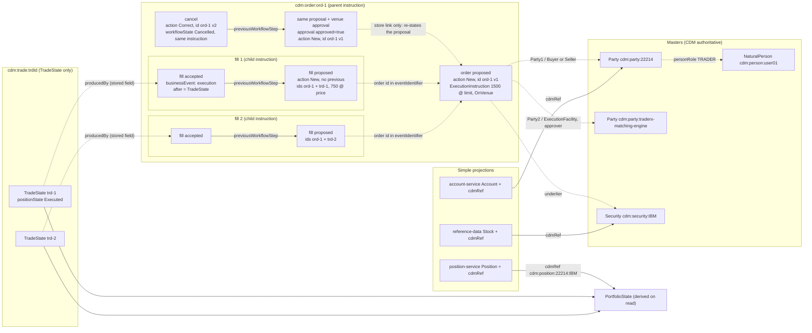

# CDM Mapping Specification: TraderX to FINOS CDM 7.8.0

This document defines how state `017-cdm-lifecycle-mapping` maps TraderX objects and lifecycle events
onto the [FINOS Common Domain Model](https://cdm.finos.org) (CDM). It is the reference for anyone who
wants to read, reuse or challenge the mapping. Every rule here is implemented in
`generation/runtime-overrides/cdm-service/` and pinned by a test or a golden file.

- CDM release: `org.finos.cdm:cdm-java:7.8.0` (rune-common 12.23.0). See `../research.md` for why this
  release and which classes were confirmed in it.
- Golden CDM JSON: [`examples/`](./examples/). The files are written by `cdmObjectMapper` and
  compared byte for byte by `ExecutionMapperTest.goldenExamplesMatch`. Every JSON excerpt below is cut
  from one of them.
- REST, NATS and schema changes: [`contract-delta.md`](./contract-delta.md).
- Design amendment this version implements (fills as child execution instructions, venue approval,
  trade-state-first views): [`design/fill-instruction-model-amendment.md`](../design/fill-instruction-model-amendment.md).

## 1. Overview

TraderX keeps its simple shapes (an `accountId` integer, a ticker string, an `Order` with a status). In
state 017, FINOS CDM sits underneath them:

- **Parties, persons and securities: CDM is authoritative.** cdm-service owns them as CDM `Party`,
  `NaturalPerson` and `Security` objects. account-service, people-service and reference-data serve
  their existing shapes as projections of those objects.
- **Orders and trades: the existing tables stay the operational record.** cdm-service builds the CDM
  lifecycle (`WorkflowStep`s, the `BusinessEvent` inside each accepted step, `TradeState`) from the
  NATS events shortly after, so a failure in the lifecycle mirroring never blocks or fails an order or
  a trade. Master data is the exception: because CDM is authoritative for parties, persons and
  securities, account, people and reference-data requests (and so trade submits) depend on
  cdm-service being available (gap G8).
- **Every projection carries a `cdmRef`**, formatted `cdm:<kind>:<externalKey>`. The ref is derived
  from the TraderX id, so a synchronous response can return it before the CDM object exists. It
  resolves at `GET /cdm-service/cdm/resolve/{cdmRef}`.

### 1.1 Lineage

An order is a **parent instruction**: one CDM proposal, stated again when the venue approves it, and
corrected with status `Cancelled` if its remainder is cancelled. Each fill is a **child instruction**
with its own two-step workflow: proposed, then accepted with the execution `BusinessEvent`, whose
`after` is the fill's `TradeState`. The fills point at their order by the order id in their
identifiers, not by a CDM link (gap G13). The trade's record is the `TradeState` alone; positions are
derived from the trade states.

Solid arrows are CDM `previousWorkflowStep` links (pointing from later to earlier). Dotted arrows are
links CDM has no field for, which 017 keeps by identifier or in the store.



The fill's accepted step *contains* its `BusinessEvent`, and the event's `after` *is* the trade state
stored under `cdm:trade:<tradeId>`. That is containment, not three steps in sequence.

Two other shapes use the same parts:

- **Rejected request** (`cdm:order:<rejectionId>`): the proposal of the request as received, then
  CDM's rejected step, which also carries the venue's `approval` with `approved: false`.
- **Direct trade** (trade ticket, no order; `cdm:direct:<tradeId>`): proposed, then accepted with the
  execution event (CDM's canonical two-step flow). Its `TradeState` is under `cdm:trade:<tradeId>`
  like every other trade's, with `producedBy` pointing at the direct workflow.

### 1.2 CDM as a pre-trade model

CDM is mostly used after the trade. State 017 uses it for the order flow before the trade as well:

```text
order proposal → venue approval → child instructions (fills) → executions → trade states → positions
```

**CDM's workflow grammar.** The `Create_*` functions of cdm-java 7.8.0 enforce these conditions when
they run:

- `Create_ProposedWorkflowStep`, condition `CorrectAction`: "When the previous step is new or corrected
  and contains an instruction (proposed), the following action can only be correct." Condition
  `NewAction`: "When the previous step contains a business event, the following action can only be
  new" (also when there is no previous step). CDM sums it up as "New -> Correct and Correct -> Cancel".
- `Create_WorkflowStep`, condition `PreviousBusinessEventExists`: its previous step must contain a
  business event ("Use Create_AcceptedWorkflowStep when the previous workflow step is a proposal").
- `WorkflowStep` itself: "A workflow step is accepted if it contains a business event, proposed if
  proposedEvent is present and is rejected if the rejected flag is set."

So a CDM workflow runs: proposal → (corrections of that proposal) → one acceptance carrying a
business event → further steps. A new proposal cannot hang off another proposal, and nothing but an
acceptance, a rejection or a correction can follow a proposal.

**Why each fill is its own workflow.** A fill is a new instruction (this quantity at this price) that
is accepted by being executed. Under the grammar it cannot follow the order's proposal: as a proposal
it would have to be a `Correct` of the order, which misstates what happened, and as an acceptance
there could be only one per order. So each fill starts its own workflow (action `New`, no previous
step) and is linked to its order by the order id in its `eventIdentifier`. Every accepted step then
carries a real execution, and no step carries an empty event.

**The venue's acceptance is an approval.** When the matcher takes an order onto its book, nothing has
executed, so there is no business event to accept. CDM's `WorkflowStepApproval` ("Party approvals
associated to the current WorkflowStep") says what happened: the venue approved the proposal. 017
records it on the proposal itself (section 2.1).

**Reconstruction, said plainly.** The TraderX matcher slices orders internally and publishes only
booked trades. It never sends a fill proposal. cdm-service therefore creates each fill's proposal and
its acceptance together when the booked trade arrives, with the same timestamp (the trade time). The
link from fill to order is by identifier only: CDM has no field for it (gap G13).

**Exchange-messaging alignment.** FIX is the common exchange protocol; TraderX does not speak FIX, so
this is a correspondence, not an integration. Each FIX message a venue sends maps onto one CDM shape
above:

| FIX message (MsgType, ExecType) | Meaning | TraderX event | CDM in 017 |
|---|---|---|---|
| NewOrderSingle (`35=D`) | client sends an order | order submitted | order proposed: `Create_ProposedWorkflowStep`, action `New` |
| ExecutionReport (`35=8`), ExecType New (`150=0`) | venue accepts the order onto its book | matcher `NEW` | the proposal with `approval` `approved: true` by the venue |
| ExecutionReport, ExecType Rejected (`150=8`) | venue refuses the order | `/orders/rejected` | `Create_RejectedWorkflowStep` (`rejected`, status `Rejected`), plus `approval` `approved: false` with the reason |
| ExecutionReport, ExecType Trade (`150=F`), OrdStatus Partially filled (`39=1`) or Filled (`39=2`); LastQty (`32`), LastPx (`31`) | a fill | booked trade with `orderId` | fill proposed (child `ExecutionInstruction` for LastQty at LastPx) + fill accepted (execution `BusinessEvent`, `after` = `TradeState`) |
| OrderCancelRequest (`35=F`), then ExecutionReport, ExecType Canceled (`150=4`) | client cancels the rest; venue confirms | matcher `CANCELED` | `Correct` of the proposal with `workflowState` `Cancelled` |

**CLOB versus RFQ and block venues.** On a central limit order book the matching engine proposes and
accepts a match in one moment and reports only the fill, so cdm-service's reconstruction matches what
happens there. On RFQ, block and bilateral venues the fill's proposal and its acceptance are two real
messages (a quote, then the client's acceptance). The CDM shape is the same; only the two timestamps
differ.

## 2. Event mapping

| TraderX event | Source | CDM representation | Stored under | Golden |
|---|---|---|---|---|
| Order submitted (`NEW` on `/orders`) | order-matcher | `Create_ProposedWorkflowStep`: action `New`, no previous step, `eventIdentifier` = order id version 1, `proposedEvent` with one `ExecutionInstruction` (order quantity at the limit price, `executionType OnVenue`) | `cdm:order:<orderId>` | [`order-proposed.json`](./examples/order-proposed.json) |
| Order accepted by the matcher (same `NEW` event; TraderX accepts synchronously) | order-matcher | the proposal stated again with `approval` = [`WorkflowStepApproval` `approved: true`, party = venue, timestamp]: `Create_ProposedWorkflowStep` re-run with the proposal's own inputs, action `New`, same version-1 identifiers, no `previousWorkflowStep` (section 2.1) | `cdm:order:<orderId>` | [`order-approved.json`](./examples/order-approved.json) |
| Order rejected (invalid create, HTTP 400) | order-matcher `/orders/rejected` | proposal of the request as received, then `Create_RejectedWorkflowStep` (`rejected: true`, `workflowStatus Rejected`, reason in `workflowState.comment`) with `approval` `approved: false` and the `rejectedReason` | `cdm:order:<rejectionId>` | [`order-rejected.json`](./examples/order-rejected.json) |
| Fill (`PARTIALLY_FILLED` or `FILLED`, booked trade with `orderId`) | trade-processor `/trades/booked` | its own workflow: **fill proposed** (`Create_ProposedWorkflowStep`, action `New`, no previous step, identifiers = order id + trade id, child `ExecutionInstruction` for the fill quantity at the fill price) and **fill accepted** (`Create_AcceptedWorkflowStep` carrying `Create_BusinessEvent`, `after` = `TradeState` with `positionState Executed`) | both steps under `cdm:order:<orderId>`; the `TradeState` alone under `cdm:trade:<tradeId>` with `producedBy` | [`fill-proposed.json`](./examples/fill-proposed.json), [`fill-accepted.json`](./examples/fill-accepted.json) |
| Cancel (`CANCELED` on `/orders`) | order-matcher | `Create_ProposedWorkflowStep`: action `Correct`, `previousWorkflowStep` = the latest proposal version, the same instruction (quantity not reduced), identifier version 2, `workflowState` `Cancelled` with a comment giving the cancelled and executed quantities | `cdm:order:<orderId>` | [`order-cancel-remainder.json`](./examples/order-cancel-remainder.json) |
| Direct trade (booked trade with no `orderId`) | trade-processor `/trades/booked` | proposed (the trade as an instruction, `executionType Electronic`) → accepted (execution `BusinessEvent`, `after` = `TradeState`) | steps under `cdm:direct:<tradeId>`; `TradeState` under `cdm:trade:<tradeId>` | [`direct-trade.json`](./examples/direct-trade.json) |

The `PARTIALLY_FILLED` and `FILLED` order events themselves store nothing
(`LifecycleAdapterTest.partiallyFilledAndFilledStoreNothing`). The booked trade is the execution, so
fills are never counted twice. No `BusinessEvent` is ever stored on its own: it lives in its accepted
step (`LifecycleAdapterTest.noBusinessEventStoredStandalone`).

### 2.1 Order proposed and approved

The proposal carries the order as an `ExecutionInstruction`. CDM has no limit-price concept, so the
limit is the instruction's `AssetPrice`. The fills carry the real prices. `Min`/`Max` operator prices
were rejected: they mean a formula on an observable, not "no worse than".

When the matcher accepts the order, cdm-service stores the **same proposal again with the venue's
approval** (Ruling R43). It is built by `Create_ProposedWorkflowStep` from the proposal's own inputs
(timestamps, identifiers, `proposedEvent`, action `New`, no previous step) plus that function's
`approval` input, "the approval status of all parties on the proposed event". Excerpt of
[`order-approved.json`](./examples/order-approved.json):

```json
{
  "approval" : [ {
    "approved" : true,
    "party" : { "externalReference" : "traderx-matching-engine" },
    "timestamp" : { "dateTime" : "2026-10-29T14:30:00Z", "qualification" : "eventCreationDateTime" },
    "meta" : { "globalKey" : "b32dbc87" }
  } ],
  "proposedEvent" : { "...": "the order's ExecutionInstruction, unchanged" },
  "timestamp" : [ { "dateTime" : "2026-10-29T14:30:00Z", "qualification" : "eventCreationDateTime" } ],
  "eventIdentifier" : [ { "issuer" : { "value" : "TraderX" },
    "assignedIdentifier" : [ { "identifier" : { "value" : "ord-013-0101",
      "meta" : { "scheme" : "https://traderx.finos.org/order-id" } }, "version" : 1 } ] } ],
  "action" : "New",
  "meta" : { "globalKey" : "215028ba", "externalKey" : "ord-013-0101:approved" }
}
```

What this means for a CDM consumer:

- **Two version-1 instances.** The submitted proposal (`meta.globalKey` `477ac0a5`, external key
  `ord-013-0101:proposed`) and the approved one (`215028ba`, `ord-013-0101:approved`) carry the same
  event identifier, `ord-013-0101` version 1. A consumer that keys workflow steps on
  (identifier, version) sees two instances of one version. They differ only by the `approval`.
  `Correct` (version 2) would have kept the keys apart, but CDM defines it as "a correction of a prior
  instance of the transaction event", and nothing in the instruction was corrected.
- **No CDM link between them.** The approved version has no `previousWorkflowStep` (with one, CDM's
  `CorrectAction` condition would force `Correct`). The store links it to the submitted proposal
  (`previousStoreGlobalKey`), and the lineage API lists both under `proposal.versions`.
- **The approval time is the matcher's `createdAt`**, on the live path and on recovery or backfill
  alike, so every path gives the same stored object (Ruling R50). TraderX accepts orders
  synchronously, so it is also the submission time.

Execution type: the order proposal is `OnVenue`, like its fills (Ruling R44; section 6).

### 2.2 Fills

Each booked trade with an `orderId` becomes a two-step workflow (`ExecutionMapper.fill`,
`ExecutionMapperTest.fillIsItsOwnTwoStepWorkflow`):

1. **Fill proposed.** `Create_ProposedWorkflowStep`, action `New`, no previous step. The
   `proposedEvent` is a child `ExecutionInstruction`: the trade as booked (fill quantity at the fill
   price, with the gross consideration), the same product, parties and trade date as the order, trade
   identifier = the trade id (scheme `trade-id`), `executionType OnVenue`.
2. **Fill accepted.** `Create_AcceptedWorkflowStep` with `previousWorkflowStep` = the fill proposal, the
   same identifiers, an `executionDateTime` timestamp at the trade time, `workflowStatus Accepted`, and
   the execution `BusinessEvent` built by `Create_BusinessEvent` from the proposal's instruction. The
   event's `after` is the fill's `TradeState` (`positionState Executed`). It has no `intent`, so
   `Qualify_Execution` is true (`ExecutionMapperTest.everyExecutionQualifies`).

**Identifiers (Ruling R42).** Both steps carry two `eventIdentifier`s issued by TraderX, version 1: the
order id (scheme `https://traderx.finos.org/order-id`), which is the link to the order, and the trade id
(scheme `https://traderx.finos.org/fill-id`), which keeps every fill distinct
(`ExecutionMapperTest.fillCarriesOrderAndTradeIdentifiers`). Excerpt of
[`fill-proposed.json`](./examples/fill-proposed.json):

```json
{
  "proposedEvent" : { "...": "ExecutionInstruction for the fill: 750 at 179.500, executionType OnVenue" },
  "timestamp" : [ { "dateTime" : "2026-10-29T14:30:05Z", "qualification" : "eventCreationDateTime" } ],
  "eventIdentifier" : [ {
    "issuer" : { "value" : "TraderX" },
    "assignedIdentifier" : [ { "identifier" : { "value" : "ord-013-0101",
      "meta" : { "scheme" : "https://traderx.finos.org/order-id" } }, "version" : 1 } ]
  }, {
    "issuer" : { "value" : "TraderX" },
    "assignedIdentifier" : [ { "identifier" : { "value" : "trd-017-0001",
      "meta" : { "scheme" : "https://traderx.finos.org/fill-id" } }, "version" : 1 } ]
  } ],
  "action" : "New",
  "meta" : { "globalKey" : "c9079c06", "externalKey" : "trd-017-0001:proposed" }
}
```

Excerpt of [`fill-accepted.json`](./examples/fill-accepted.json) (instruction, product and parties
removed):

```json
{
  "businessEvent" : {
    "eventDate" : "2026-10-29",
    "effectiveDate" : "2026-10-29",
    "instruction" : [ { "...": "the fill proposal's ExecutionInstruction" } ],
    "after" : [ {
      "trade" : {
        "tradeLot" : [ { "priceQuantity" : [ {
          "price" : [ { "value" : { "value" : 179.500, "unit" : { "currency" : { "value" : "USD" } },
            "perUnitOf" : { "financialUnit" : "Share" }, "priceType" : "AssetPrice",
            "priceExpression" : "AbsoluteTerms",
            "derivedQuantity" : { "value" : 134625.000, "unit" : { "currency" : { "value" : "USD" } } } } } ],
          "quantity" : { "value" : { "value" : 750, "unit" : { "financialUnit" : "Share" } } } } ] } ],
        "executionDetails" : { "executionType" : "OnVenue",
          "executionVenue" : { "name" : { "value" : "TraderX Matching Engine" } } },
        "tradeIdentifier" : [ { "issuer" : { "value" : "TraderX" }, "assignedIdentifier" : [ { "identifier" :
          { "value" : "trd-017-0001", "meta" : { "scheme" : "https://traderx.finos.org/trade-id" } } } ] } ]
      },
      "state" : { "positionState" : "Executed" },
      "meta" : { "globalKey" : "99d25d58" }
    } ]
  },
  "previousWorkflowStep" : { "globalReference" : "c9079c06", "externalReference" : "trd-017-0001:proposed" },
  "timestamp" : [ { "dateTime" : "2026-10-29T14:30:05Z", "qualification" : "executionDateTime" } ],
  "eventIdentifier" : [ { "...": "the same two identifiers as the fill proposal" } ],
  "action" : "New",
  "workflowState" : { "workflowStatus" : "Accepted" },
  "meta" : { "globalKey" : "b0d8ca71", "externalKey" : "trd-017-0001:accepted" }
}
```

Further rules:

- No `before` state, because CDM's `Instruction` condition `NewTrade` forbids one with an execution.
  Each fill is one new CDM trade.
- **The fill maps against the latest proposal version of its order** (the approved one), never against
  another fill's step. A fill arriving before the order's approved version is parked until it is
  stored.
- **Fill numbers are not stored.** The lineage API numbers fills at read time in booking order (trade
  time, then trade id), so a live run and a `--reset-data` rebuild number them the same
  (`LineageControllerTest.fillNumbersFollowBookingOrderNotArrival`,
  `.fillNumbersBreakTimeTiesByTradeId`). The fill that first reaches the instruction quantity is
  labelled "Full fill" if it is fill 1, else "Final fill N"; every other fill is "Partial fill N"
  (`.singleCompleteFillIsFullFill`).
- Executed quantity = Σ of the accepted fills' trade lot quantities. Remaining quantity =
  instruction quantity − executed − cancelled. Neither is stored in CDM (gap G1).
- The trade's record is its `TradeState` only, under `cdm:trade:<tradeId>`, with `producedBy` = the
  accepted fill step (section 8.4).

### 2.3 Cancel of the unfilled remainder

The cancel is a **correction of the order's proposal with status `Cancelled`**
(`WorkflowMapper.cancelCorrection`): `Create_ProposedWorkflowStep` with action `Correct` and
`previousWorkflowStep` = the latest proposal version (the approved one). CDM's `CorrectAction`
condition requires `Correct` after a proposal. `Cancel` is allowed only after a `Correct`
("New -> Correct and Correct -> Cancel"), and `Create_WorkflowStep` needs a previous step with a
business event, which a proposal does not have.

- **The instruction is kept as it was** (1500 shares in the example). Reducing it to the executed
  quantity would give a zero-quantity instruction for an order cancelled before any fill.
- The cancelled remainder (the matcher's `canceledQuantity`, Ruling R25) and the executed quantity are
  stated in `workflowState.comment`. The fills are their own workflows with their own trade states, so
  they are untouched and the executed quantity stays their sum.
- Event identifier: the order id, version 2 (CDM `ActionEnum.Correct`: "The eventIdentifier has an
  associated version greater than 1"). No `approval`: the approval belongs to the version it was given
  on.

Excerpt of [`order-cancel-remainder.json`](./examples/order-cancel-remainder.json) (750 cancelled after
one 750 fill):

```json
{
  "previousWorkflowStep" : { "globalReference" : "215028ba", "externalReference" : "ord-013-0101:approved" },
  "proposedEvent" : { "...": "the order's instruction, quantity 1500 as proposed" },
  "timestamp" : [ { "dateTime" : "2026-10-29T14:31:00Z", "qualification" : "eventCreationDateTime" } ],
  "eventIdentifier" : [ { "issuer" : { "value" : "TraderX" },
    "assignedIdentifier" : [ { "identifier" : { "value" : "ord-013-0101",
      "meta" : { "scheme" : "https://traderx.finos.org/order-id" } }, "version" : 2 } ] } ],
  "action" : "Correct",
  "workflowState" : { "workflowStatus" : "Cancelled",
    "comment" : "Unfilled remainder of 750 shares cancelled; 750 executed by fills, which stand" },
  "meta" : { "globalKey" : "701cc141", "externalKey" : "ord-013-0101:cancel" }
}
```

The lineage API's `canceledQuantity` is read back from that comment (`WorkflowMapper.canceledQuantity`,
Ruling R48), because CDM has no structural home for it here (gap G15). If the comment cannot be read,
the API falls back to instruction − executed and says so in `quantityWarning`.

### 2.4 Rejected order

009 never stored a rejected order: an invalid create returned 400. In 017 the matcher also publishes
the request on `/orders/rejected` (rejection id `rej-<uuid>`). cdm-service stores two objects under
`cdm:order:<rejectionId>`:

- a proposal of the request as received (`executionType OnVenue`, Ruling R44). Missing values are left
  out, and such a proposal validates `INVALID`, which records the problem
  (`WorkflowMapperTest.rejectedRequestWithUnknownValuesIsMappedAndReportedInvalid`);
- CDM's rejected step (`Create_RejectedWorkflowStep`): `rejected: true`, `workflowStatus Rejected`, the
  matcher's reason in `workflowState.comment` ("e.g. to specify why a transaction event was rejected by
  a party", in CDM's own words). It also carries the venue's `approval` with `approved: false` and the
  `rejectedReason` (Ruling R45). `Create_RejectedWorkflowStep` has no approval input, so the approval is
  added to its output.

```json
{
  "rejected" : true,
  "approval" : [ { "approved" : false, "party" : { "externalReference" : "traderx-matching-engine" },
    "rejectedReason" : "invalid order payload",
    "timestamp" : { "dateTime" : "2026-10-29T14:29:00Z", "qualification" : "eventCreationDateTime" } } ],
  "previousWorkflowStep" : { "globalReference" : "e7db4618", "externalReference" : "rej-017-0001:proposed" },
  "workflowState" : { "workflowStatus" : "Rejected", "comment" : "invalid order payload" },
  "meta" : { "globalKey" : "a6d53ecb", "externalKey" : "rej-017-0001:rejected" }
}
```

**What the matcher rejects.** Only a payload it cannot take: missing fields, or a quantity of 0 or
less (scenario (d) sends quantity 0; that proposal validates `VALID`). The matcher does not check
reference data, so an order for an **unknown ticker or account is not rejected**: the matcher accepts
it, and cdm-service cannot map it and records a lifecycle failure row instead (gap G17, Ruling R56).
No rejected workflow exists for such an order.

### 2.5 Direct trade

A trade booked from the trade ticket (no `orderId`) is CDM's canonical two-step flow under
`cdm:direct:<tradeId>` (`ExecutionMapper.direct`,
`ExecutionMapperTest.directTradeIsProposedThenAcceptedWithItsExecution`): a proposal (the trade at its
booked price, identified by the trade id with scheme `trade-id`, `executionType Electronic`), then the
accepted step with the execution `BusinessEvent`. Its `TradeState` is stored under
`cdm:trade:<tradeId>` with `producedBy` = the direct workflow's accepted step. `cdm:direct` is a
cdm-service lookup address, not a CDM concept (Ruling R53). Trade-service's 009 seed trades are
imported this way at startup (gap G9).

Excerpt of the accepted step in [`direct-trade.json`](./examples/direct-trade.json) (a 200-share
sell):

```json
{
  "businessEvent" : { "...": "execution of 200 shares; after = TradeState with executionType Electronic" },
  "previousWorkflowStep" : { "globalReference" : "8a15add1", "externalReference" : "trd-017-0100:proposed" },
  "timestamp" : [ { "dateTime" : "2026-10-29T15:00:00Z", "qualification" : "executionDateTime" } ],
  "eventIdentifier" : [ { "issuer" : { "value" : "TraderX" },
    "assignedIdentifier" : [ { "identifier" : { "value" : "trd-017-0100",
      "meta" : { "scheme" : "https://traderx.finos.org/trade-id" } }, "version" : 1 } ] } ],
  "action" : "New",
  "workflowState" : { "workflowStatus" : "Accepted" },
  "meta" : { "globalKey" : "d0d319e5", "externalKey" : "trd-017-0100:accepted" }
}
```

## 3. Party, person and venue mapping

| TraderX | CDM | Key fields | Stored under |
|---|---|---|---|
| Account `{id, displayName}` | `cdm.base.staticdata.party.Party` | `partyId[0].identifier` = account id, scheme `https://traderx.finos.org/account-id`; `name` = display name; `meta.externalKey` = account id | `cdm:party:<accountId>` |
| Account user `{accountId, username}` | `Party.person` (identifier-only `NaturalPerson`) + `Party.personRole` (`NaturalPersonRole`, role `TRADER`, `personReference.externalReference` = logon id) | persons and roles sorted by logon id | inside the account Party |
| Person `{logonId, fullName, email, employeeId, department, photoUrl}` | `NaturalPerson` | `personId`: logon id (scheme `https://traderx.finos.org/logon-id`), employee id (`identifierType EMPL`), department (scheme `https://traderx.finos.org/department`), photo URL (scheme `https://traderx.finos.org/photo-url`); `firstName`/`surname` = `fullName` split at the first space; `contactInformation.email` | `cdm:person:<logonId>` |
| Order matcher (execution venue) | `Party` | `partyId` `traderx-matching-engine`, scheme `https://traderx.finos.org/venue-id`; name "TraderX Matching Engine". It is also the party of every `WorkflowStepApproval`. | `cdm:party:traderx-matching-engine` |

Rules:

- **Single person authority (Ruling R19).** A Party never embeds a copy of person data. It holds
  identifier-only persons (logon id and external key). `GET /cdm/parties/{id}` resolves them against
  `cdm:person:<logonId>` at read time (`PartyEndpointsTest.cdmPartyEndpointResolvesFullPersonsFromMaster`).
- **Identifier-only persons (Rulings R19, R20).** A username with no people-service record (009's
  `PUT /accountuser/` allowed this) is stored as an identifier-only `NaturalPerson`, so its `cdmRef`
  always resolves (`PartyMasterTest.unknownUserRefResolves`). Such persons are not in the people-service
  directory: list, search and `GetPerson` answer as if they did not exist, which keeps 009's directory
  semantics (`PeopleEndpointsTest.identifierOnlyPersonsAreNotInTheDirectory`).
- **Department and photo URL are TraderX extensions.** CDM `NaturalPerson` has neither. They are stored
  as `PersonIdentifier`s with a TraderX scheme, which round-trips exactly
  (`PersonProjectionTest.photoUrlIsATraderxSchemeIdentifier`). `ContactInformation.webPage` was
  rejected for the photo: a photo is not the person's web page.
- `PartyIdentifierTypeEnum` has only `BIC`, `LEI` and `MIC`, so account and venue identifiers have a
  scheme but no identifier type. `MIC` was not used for the venue because the matcher has no real
  market identifier code.
- `PartyRole`/`Counterparty` and `RelatedParty` were rejected for account users: they relate a party to
  a trade or to another party, not a person to a party.
- **Length limits.** The party master still writes the 009 `accounts` and `accountusers` rows as
  foreign-key anchors, so it enforces their limits before writing: `displayName` at most 50 characters,
  `username` at most 15. A longer value is a 400 (`PartyMasterTest.displayNameOver50IsRejectedWith400AndCreatesNothing`,
  `usernameOver15IsRejectedWith400`).

## 4. Security mapping

| TraderX | CDM `Security` field | Value |
|---|---|---|
| (fixed) | `assetType` | `Security` (required by the `AssetType` condition) |
| (fixed) | `securityType` | `Equity` |
| (fixed) | `equityType.equityType` | `Ordinary` |
| `ticker` | `identifier[]` `identifierType ExchangeCode` | e.g. `IBM`; matched exactly and case-sensitively, as reference-data always did |
| demo ISIN | `identifier[]` `identifierType ISIN`, scheme `https://traderx.finos.org/demo-identifier` | `XX` + 9 base-36 hash characters + ISO 6166 check digit, e.g. `XXIMQIJLGP45` |
| demo FIGI | `identifier[]` `identifierType FIGI`, scheme `https://traderx.finos.org/demo-identifier` | `BBG` + 8 consonant/digit hash characters + OpenFIGI check digit, e.g. `BBG821ZC5JC3` |
| `companyName` | `identifier[]` `identifierType Name` | e.g. `International Business Machines` (CDM `Security` has no name attribute) |

- `ExchangeCode` ("The identifier follows the symbology set by the exchange which lists the asset.") is
  what a TraderX ticker is. `BBGTICKER` and `RIC` were rejected: they name vendor symbologies.
- **Demo identifiers are synthetic.** The `XX` prefix is not an ISO 3166 country code, so the ISINs
  cannot collide with real ones. The FIGIs were never issued by OpenFIGI. Both carry the
  `demo-identifier` scheme and the UI labels them "demo identifier". The derivation is in
  `../research.md` (Demo Identifier Scheme) and pinned by `DemoIdentifiersTest.demoValuesAreStableAcrossReleases`.
- The seed is reference-data's 509 stocks, in CSV order, with `FB` → `META` and preferred names
  (`SecurityMasterTest.seedKeepsReferenceDataTickersNamesAndOrder`).

## 5. Product, prices and settlement defaults

TraderX has no product, currency or settlement terms. These defaults are stated, not derived:

| Concern | Default | CDM encoding |
|---|---|---|
| Product | cash equity | `NonTransferableProduct` with one `SettlementPayout` from `Create_NonTransferableProduct`; `underlier` = `Observable → Asset → Instrument → Security` (the master's Security) |
| Currency | **USD**, single currency | `settlementCurrency USD`; price `unit.currency USD` |
| Settlement | **T+2 business days**, **delivery versus payment** | `settlementType Physical`, `transferSettlementType DeliveryVersusPayment`, `settlementDate.adjustableOrRelativeDate.relativeDate` = `periodMultiplier 2`, `period D`, `dayType Business`, relative to `tradeDate`. No business-centre calendar, so no adjusted date is computed. |
| Settlement centres | required by CDM, no TraderX meaning | `securitySettlementCentre SecuritySettlementCentre`, `cashSettlementCentre CashSettlementCentre` (the `SettlementCentreRequired` condition demands both for a security underlier) |
| Payer / receiver | seller delivers the shares | account = `Party1`, venue = `Party2`; buy → payer `Party2`, receiver `Party1`; sell → the reverse |
| Quantity | shares, integer | `quantity` with `unit.financialUnit Share` |
| Price | per share, 3 decimals, half-up | `PriceTypeEnum.AssetPrice`, `perUnitOf Share`, `priceExpression AbsoluteTerms`; on fills `derivedQuantity` = gross consideration in USD (checked by CDM's `PriceQuantityTriangulation`) |
| Roles | account side, venue opposite | `partyRoles`: `Buyer`/`Seller` from the account's side, venue takes the other plus `ExecutionFacility` |
| Execution details | the matcher as venue | `executionType OnVenue` for orders and fills, `Electronic` for direct trades (section 6); `executionVenue` = `LegalEntity` "TraderX Matching Engine" on both |
| Identifiers | issuer `TraderX` | schemes `https://traderx.finos.org/order-id`, `.../trade-id`, `.../fill-id` (fill steps only, Ruling R42), `.../rejection-id` |
| Times | UTC, millisecond precision | step `timestamp` (`eventCreationDateTime`, or `executionDateTime` on accepted fill and direct steps); `tradeDate`/`eventDate` = UTC date of the TraderX instant |

## 6. Execution, TradeState and trade state labels

- **Trade lot price = the price trade-service booked** (`ExecutionMapperTest.tradeLotPriceIsBookedPrice`).
  The `TradeState` must match the booked trade.
- **Counterparties:** account `Party1`, venue `Party2`. The account users are not copied onto trades:
  they are entitlements, and copying them would change every trade when a user is added.
- **Why the venue is the counterparty.** TraderX's order matcher does not cross two client orders. It
  fills an order against the price feed when the limit is marketable (or on an admin force-fill), and
  there is no contra order and no other client on the far side of the fill. The only party that takes
  the other side of every TraderX trade is therefore the matcher itself, so 017 models the venue as the
  principal counterparty (`Party2`, with the opposite `Buyer`/`Seller` role) as well as the
  `ExecutionFacility`. This is a modelling choice, not something CDM dictates, and other models fit
  other readings of TraderX. They are left as future work for the CDM maintainers' input:
  - **CCP novation:** the venue (or a separate clearing party) is replaced as counterparty by a
    central counterparty through a CDM novation business event (qualified by `Qualify_Novation` in
    7.8.0), which is how exchange-traded equities usually end up.
  - **A contra or house account:** a TraderX-owned principal account takes the far side, and the venue
    appears only as `ExecutionFacility`. Positions of that house account would then be visible in CDM.
  - **An agency model:** the venue acts as agent and appears only in `ExecutionDetails`
    (`executionVenue`), with the counterparty being the (unknown, external) market. This needs a
    placeholder counterparty party, because a CDM `Trade` requires exactly two counterparties
    (`counterparty` cardinality 2..2 in `TradeValidator`).
- **Execution type.** `ExecutionDetails.executionType` is CDM's `ExecutionTypeEnum`, "The enumerated
  values to specify how a contract has been executed, e.g. electronically, verbally, ...". 017 uses two
  of its values (`ExecutionMapperTest.fillIsOnVenueDirectIsElectronic`):

  | Value | Used on | CDM 7.8.0's definition (`event-common-enum.rosetta`) | Meaning shown by TraderX (`executionTypeMeaning`) |
  |---|---|---|---|
  | `OnVenue` | every matcher fill; the order proposal and a rejected request's proposal (Ruling R44) | "Execution via a platform that may or may not be covered by a regulatory defintion. OnVenue is intended to distinguish trades executed on a trading platform from those executed via phone, email or messaging apps. The role and details of the venue are included in the party attribute of the trade. The general rule is that if the parties utilitzed the services of the platform to execute the trade then it would be considered OnVenue." | fill: "Executed by the TraderX matching engine (the venue, Party2)"; order proposal: "Sent to the TraderX matching engine (the venue, Party2)" |
  | `Electronic` | direct trades (trade ticket, no matcher) | "Execution via electronic execution facility, derivatives contract market, or other electronic message such as an instant message." | "Booked electronically from the trade ticket, not matched" |

  The CDM definitions are quoted verbatim, spelling included. The venue's role and details are in the
  trade's parties, as `OnVenue` asks (the matcher is `Party2` and `ExecutionFacility`). CDM's
  `ExecutionVenue` condition requires `executionVenue` only for `Electronic`; 017 sets it on both.
  `OffFacility` ("Bilateral execution between counterparties not pursuant to the rules of a SEF or
  DCM") is not used. The meaning is shown wherever the value is: in the lineage and trade APIs
  (`executionTypeMeaning` next to `executionType`) and in the CDM view (caption and tooltip).
- **`TradeState.state.positionState` is always `EXECUTED` for a live trade (Ruling R37).** TraderX's
  trade-processor sets `New → Processing → Settled` in one transaction, with no transfer and no
  settlement event. Recording `SETTLED` without a CDM `Transfer` would misstate CDM semantics. The
  mapping is (`ExecutionMapper.positionState`, `ExecutionMapperTest.tradeStateCarriesPositionState`):

  | TraderX `trades.state` | CDM `positionState` | Round trip |
  |---|---|---|
  | `New`, `Processing`, `Settled` | `Executed` | lossy: the three labels cannot be told apart on the way back |
  | `Cancelled` | `Cancelled` | lossless |

## 7. Positions

Positions are a CDM `cdm.event.position.PortfolioState`, derived on every read from the latest
`TradeState` of every `cdm:trade:` ref whose `Party1` is the account. Nothing is stored.

- One `Position` per security. Quantity = Σ trade lot quantity, plus when the account is `Buyer`, minus
  when it is `Seller`. `averageCostBasis` repeats 009 trade-processor's arithmetic, trade by trade
  (`PositionViewTest.positionQuantityMatchesSumOfSignedExecutions`).
- CDM quantities are non-negative, so a short position is expressed by direction: the account is the
  payer of the settlement payout (`PositionViewTest.shortPositionIsTheAccountPayingTheShares`).
- A trade state the account is neither buyer nor seller of, or that cannot be read, is listed in
  `skipped` and never treated as a sale.
- Lineage: `lineage.eventReference` points at the accepted steps that produced the trade states (found
  through each trade state's `producedBy`), and `lineage.tradeReference` at the trades (by Rune
  `cdmGlobalKey`). The state references an initial, empty state by external key `<accountId>:initial`,
  because CDM's `Initialisation` condition only allows positions in a state that has a previous state.
  Rune gives a content-less object no global key, so the reference is by external key only, and the
  initial state itself is not served.
- **The trade states behind each holding.** `GET /cdm/positions/{accountId}` also lists, per security,
  the contributing trade states (`positions[i].trades`: trade id, `cdmRef`, signed quantity, price,
  side, execution time) in execution order. Their signed quantities sum to the position's quantity
  (`LineageControllerTest.positionTradesSumToQuantity`).
- **An account with no CDM trades (or an unknown account) answers 404 `{"cdmRef", "status":"pending"}`**
  on `/cdm/positions/{accountId}` and on `cdm:position:<accountId>` (Ruling R30). See gap G4.
- Each position-service row carries `cdmRef` `cdm:position:<accountId>:<ticker>`, which resolves to
  that one CDM `Position`.

## 8. Keys and references

### 8.1 cdmRef

`cdm:<kind>:<externalKey>`, kind one of `party`, `person`, `security`, `order`, `trade`, `direct`,
`position`. The key may itself contain `:` (`cdm:position:22214:IBM`). Parsing: `CdmRef.parse`
(`CdmRefTest`).

| Kind | Example | Resolves to |
|---|---|---|
| `party` | `cdm:party:22214`, `cdm:party:traderx-matching-engine` | `Party` with full persons |
| `person` | `cdm:person:user01` | `NaturalPerson` |
| `security` | `cdm:security:IBM` | `Security` |
| `order` | `cdm:order:ord-013-0001`, `cdm:order:rej-…` | the order's own latest version: the cancel if there is one, else the latest proposal version (approved, or rejected for a rejection id). Never a fill step, although the fill steps are stored under the same ref (Ruling R54). With `Link: </cdm/orders/{id}/lineage>; rel="lineage"`. |
| `trade` | `cdm:trade:<tradeId>` | the `TradeState`, the only object under the ref |
| `direct` | `cdm:direct:<tradeId>` | the direct trade's workflow as a CDM `cdm.event.workflow.Workflow` `{steps: [proposed, accepted]}`, built on read from the stored steps. `X-CDM-Validation` is the worst stored status of its steps; there is no `X-CDM-Global-Key`, because the `Workflow` is not stored. With `Link: </cdm/trades/{id}/lineage>; rel="lineage"`. |
| `position` | `cdm:position:22214` / `cdm:position:22214:IBM` | `PortfolioState` / one `Position` |

`cdm:direct` is a cdm-service lookup address, not a CDM concept: it lets `cdm:trade:<tradeId>` hold
only the `TradeState` for every trade, whether it was a fill or a direct trade.

An unknown ref answers 404 `{"cdmRef": "...", "status": "pending"}`: valid refs are derived
deterministically, so "not there yet" is a normal state while the adapter catches up. A malformed ref
answers 400.

### 8.2 Two kinds of global key (Ruling R29)

| Name | What it is | Used for |
|---|---|---|
| `storeGlobalKey` (also `previousStoreGlobalKey`, `stepStoreGlobalKey`) | SHA-256 (lower-case hex) of the object's canonical JSON; `cdm_documents.global_key` | navigating and joining stored versions; the `X-CDM-Global-Key` response header; `producedBy.storeGlobalKey` |
| `cdmGlobalKey` (also `tradeCdmGlobalKey`, `executionStepCdmGlobalKey`) | the object's Rune `meta.globalKey`, a short content hash from `GlobalKeyProcessStep` | joining CDM-internal references: `previousWorkflowStep.globalReference`, `PortfolioState` lineage |

Every API response that exposes a key carries both. **On the `cdm.*` NATS subjects the payload field
`globalKey` is the store key** (`storeGlobalKey`); the Rune key is inside `object.meta.globalKey`.

The Rune key is a 32-bit content hash, so two different objects can share it, and a wrapper and its
only child can hash the same. It is never used as a primary key: `cdm_documents` uses a surrogate
`id` and the SHA-256 store key (Ruling R14).

### 8.3 Versions and idempotency

`cdm_documents` keeps one row per stored object, in write order. Its `previous_global_key` always
means "the step this one follows in its workflow" (Ruling R49), so it agrees with the CDM
`previousWorkflowStep` wherever CDM has one:

| Row | `previous_global_key` | CDM `previousWorkflowStep` |
|---|---|---|
| order proposal (as submitted) | none | none |
| approved version of the proposal | the submitted proposal | none (section 2.1) |
| fill proposed | none: it starts its own workflow | none |
| fill accepted | its fill proposal | its fill proposal |
| cancel | the latest proposal version | the latest proposal version |
| direct trade proposed / accepted | none / the proposal | none / the proposal |
| `TradeState` | none (a later version would link to the previous `TradeState` of the same ref) | not a step |

Redelivered events write nothing: the adapter checks, under the order's lock, which steps are already
stored (by global key and fill id) and stores only the missing ones, so a crash between two writes
resumes where it stopped (`LifecycleAdapterTest.redeliveredFillWritesNothing`,
`.fillResumesAfterPartialWrite`, `.newOrderAfterAPartialWriteStoresOnlyTheApproval`,
`CdmStoreTest.putIsIdempotentForIdenticalContent`). Upgrading `cdm-java` can change serialised
content, and with it every store key: the masters then store new versions on the next start.

### 8.4 Produced by

A `TradeState` row has a stored "produced by" reference (`cdm_documents.produced_by_ref` and
`produced_by_global_key`): the ref and store key of the accepted step whose business event produced it
(a fill step under `cdm:order:<orderId>`, or the direct trade's accepted step under
`cdm:direct:<tradeId>`). It is a field of its own, not the store's version link, because version links
stay within one ref; that keeps idempotency and "latest version" meaning what they did
(`CdmStoreTest.putWithProducedByStoresItAndLinksVersionsWithinTheRef`). The trade APIs answer with the
trade state first, then `producedBy` (kind `fill` with the order id, fill number and label, or kind
`direct`) (`LineageControllerTest.tradeLeadsWithTradeStateAndProducedBy`,
`.directTradeProducedByDirectWorkflow`).

## 9. Validation bar

- **Type, cardinality and data rules:** `CdmValidator.validate` runs rune-common's
  `RosettaTypeValidator` over the whole object tree: the generated cardinality validator, the
  type-format validator and every data-rule condition of each type.
- **Qualification:** the `BusinessEvent` of every accepted fill or direct step must also satisfy
  `Qualify_Execution`. If it does not, the step's result is `NOT_QUALIFIED` with
  `Qualify_Execution=false` as its first message.
- **No empty events.** Every accepted step carries an execution with an `after` trade state
  (`ExecutionMapperTest.noAcceptedStepHasAnEmptyEvent`); the venue's acceptance of an order is an
  approval, not an accepted step (`WorkflowMapperTest.venueApprovalIsNotAnAcceptance`).
- **Mismatched fills** (side, security or account differ from the order's proposal) are stored as
  booked and flagged `INVALID` with `fill does not match the order: ...` on **both** fill steps, since
  both carry the mismatching child instruction (`ExecutionMapperTest.mismatchedFillWorkflowIsFlagged`).
- **Results are data, not a gate.** A result is stored with each version, exported as
  `traderx_cdm_objects_total{type,validation}`, shown in the CDM view and summarised at
  `/cdm/validation-summary`. It is never thrown to the TraderX caller. Mapping failures (an exception
  in a mapper, an unknown order or security) are logged, counted in `traderx_cdm_failures_total{stage}`,
  stored in `cdm_lifecycle_failures` and shown in the lineage `failures` list.
- All golden examples validate `VALID`. The smoke run (scenario f) requires that no stored object is
  `INVALID` or `NOT_QUALIFIED` and that no `BusinessEvent` is stored on its own.

## 10. Translation rules (summary)

1. CDM objects are built with CDM's own `Create_*` functions wherever one exists, never with a
   misleading action to satisfy a condition. Only their inputs, and attributes they have no input
   for, are assembled by hand: the `approval`, repeated `proposedEvent` and reason on the rejected
   step, and the `positionState` on a trade state. No business event is hand-assembled.
2. Mappers are pure: every timestamp and id comes from the TraderX input, so the same input always gives
   the same JSON (`WorkflowMapperTest.mappingIsDeterministic`). BigDecimals are normalised to scale 3
   and times to UTC before storing, so retries never create spurious versions.
3. Every TraderX id becomes a CDM `Identifier` with issuer `TraderX` and a TraderX scheme. Workflow steps
   carry `meta.externalKey` `<orderId>:proposed|approved|cancel`, `<rejectionId>:proposed|rejected` or
   `<tradeId>:proposed|accepted` (fills and direct trades), so `previousWorkflowStep` has both a global
   and an external reference.
4. References between objects in one document use `externalReference` = the party's external key
   (`22214`, `traderx-matching-engine`) or `tradeDate`.
5. Unknown or missing values are never invented. A rejected request with missing values is mapped as
   far as it goes and reported `INVALID`.
6. A mapper throws only when the lineage would be wrong (a trade of another order, a fill step given
   as an order, an unknown security). The adapter records that as a failure.

## 11. Semantic gaps

These are the places where TraderX and CDM 7.8.0 do not line up, and what 017 does about each. They
are grouped by who would close them: the CDM community (a question about, or a change to, the model),
TraderX (a change to TraderX itself), or neither, because they are the deliberate scope and defaults of
a demonstration. Gap numbers are stable identifiers and are cited across this pack.

### 11.1 Questions for the CDM community

G13 to G15 are the headline findings of using CDM for pre-trade order flow. Each needs CDM's view on
whether the representation 017 chose is the intended one, or a model change.

| # | Gap | What 017 does |
|---|---|---|
| G13 | **No way to link a child instruction to its parent instruction.** A fill is a new instruction carved out of the order. `previousWorkflowStep` cannot express that: with the order's proposal as previous step, `CorrectAction` forces `Correct` (a correction of the order, which a fill is not), and an acceptance would allow only one fill per order. Nothing else in `WorkflowStep` or `EventInstruction` refers to a parent instruction. | Each fill is its own workflow (no previous step) and carries the order id as an `eventIdentifier` under the `order-id` scheme, next to its own fill id (Ruling R42). The link is a TraderX identifier convention a CDM consumer has to know. A parent-instruction reference on `WorkflowStep` or `EventInstruction` would close it. |
| G14 | **Acceptance of an instruction that does not itself execute is expressible only as approval.** "A workflow step is accepted if it contains a business event", and the only function that builds a business event from an execution instruction executes it. A venue taking an order onto its book executes nothing. | The venue's acceptance is a `WorkflowStepApproval` (`approved: true`) on the proposal, stated again with the same identifiers, version 1, action `New` and no `previousWorkflowStep` (Ruling R43). Consequence: a consumer keyed on (identifier, version) sees two version-1 instances of the order's proposal (section 2.1). This replaces the first build's accepted step with a dates-only business event (G7). |
| G15 | **Cancelling an unexecuted proposal is a correction with status `Cancelled`.** `Cancel` may follow only a `Correct` proposal, and `Create_WorkflowStep` (which takes `Cancel`) needs a previous step with a business event. | `Create_ProposedWorkflowStep` with action `Correct`, the instruction unchanged and `workflowState` `Cancelled`. The cancelled remainder has no structural field: it is in the comment, and the lineage API parses it back (Ruling R48). The alternative, a `Correct` that reduces the instruction to the executed quantity, would leave an order cancelled before any fill with a zero-quantity instruction. |
| G1 | **CDM has no working-order state.** There is no CDM object for "an order resting at a venue with N shares open". | The order is a proposal approved by the venue, with fills as their own workflows. Open quantity is derived (instruction − Σ fills − cancelled) and reported by the lineage API, never stored in CDM. |
| G3 | **The matcher's observed price (`lastExecutionPrice`) is omitted.** Every CDM 7.8.0 home misreads it: `valuationHistory` reads as a mark for PnL, a second `AssetPrice` is ambiguous with the trade price, and `valuation`/`observation` primitives break `Qualify_Execution`. | Trade lot price = booked price. The observed price stays in the matcher's `OrderResponse`. |
| G4 | **An empty `PortfolioState` cannot be valid in CDM 7.8.0** (Ruling R30). `Initialisation` requires `positions` absent; `NonTransferable` (`positions -> product as NonTransferableProduct exists`) is false when they are absent. | Accounts without CDM trades answer 404 pending instead of serving an object that cannot validate. The initial state is referenced by external key only. |
| G5 | **`WorkflowStep` required choice.** The choice rule `CounterpartyPositionBusinessEventOrBusinessEventOrProposedEventChoice` fails on the bare output of `Create_RejectedWorkflowStep`. | The rejected step repeats the proposal's `proposedEvent`, the content that fits, and validates. `Create_RejectedWorkflowStep` has no reason input yet, so the reason goes in `workflowState.comment` and in the venue's `approval.rejectedReason`. (The first build's `Cancel` step had the same problem; the cancel is now a proposal, gap G15.) |

Where trade-state lineage leads next, not built here: the **OTC lifecycle**, where one trade (one UTI)
has a chain of `TradeState`s linked by `before`, and **block allocation**, the securities case where a
block trade state is split into allocated trade states. The structure (trade states under their own
ref, `producedBy` separate from version links) leaves room for both.

### 11.2 TraderX improvements

Closed by changing TraderX, without any change to CDM.

| # | Gap | What 017 does |
|---|---|---|
| G16 | **Fill proposals are reconstructed.** The TraderX matcher publishes booked trades only (section 1.2). | cdm-service creates each fill's proposal and acceptance together when the trade arrives, with the same timestamp. True to a central limit order book; on RFQ or block venues the two would be separate messages. |
| G17 | **TraderX gap: orders for an unknown ticker or account are not rejected** (Ruling R56). The matcher does not check reference data (inherited from 009); it rejects only payloads it cannot take (missing fields, quantity 0 or less). | The matcher accepts such an order (`NEW`). cdm-service cannot map it (an unknown security is refused) and records a lifecycle failure row, so the order has no CDM lineage, only a failure. No `INVALID` rejected proposal is produced for it. The fix belongs in the matcher: validate ticker and account, and reject through `/orders/rejected`. |
| G8 | **cdm-service down → trade submit fails** (Ruling R15). account and reference data are CDM-authoritative; trade-service validates the account and ticker against them. When cdm-service is down, account-service, people-service and reference-data answer 503, and trade-service (unchanged from 009) turns that into a 500 on `POST /trade/`. | Compose starts the dependants only once cdm-service is healthy, so this needs cdm-service to fail after start. No last-known-good cache. Order and trade lifecycle events are still never blocked by CDM: the adapter catches up from NATS and the startup backfill. |
| G9 | **Seeded and missed data** (Rulings R26, R28, R31, R32, R41). The 009 seed inserts trades and positions by SQL, never on NATS, and its seeded `PARTIALLY_FILLED`/`FILLED` orders have no booked trades. Events published while cdm-service is down are not replayed by NATS (core NATS, no JetStream). | The matcher seeds only `NEW` orders in 017 (`ORDER_MATCHER_SEED_STATUSES=NEW`). At startup cdm-service runs four passes, each idempotent and retried until its source answers, with progress in `/cdm/validation-summary` `backfill`: (1) `trades` rows with no `orderid` and no CDM trade state become direct trades (`Cancelled` rows are skipped); (2) open matcher orders (`GET /orders?status=open`) with no approved proposal get the proposal and its approval; (3) `trades` rows with an `orderid` and no CDM trade state become fill workflows of their order, in booking order, with the order read back from the matcher if its proposal is missing; (4) canceled matcher orders (`GET /orders?status=canceled`) with no cancel get the `Cancelled` correction, built from the matcher's `filledQuantity`/`canceledQuantity`; an order created and canceled entirely during the outage first gets its proposal and approval from the same response. Every pass goes through the live paths, so the backfill stores the same objects as live events (`SeedTradeBackfillTest.backfillProducesSameDocumentsAsLive`). While running, a missed `NEW` is recovered when a fill or cancel for the order arrives (Ruling R26). **Not recovered:** a direct trade booked with state `Cancelled`; a rejected order request (`/orders/rejected`) published during the outage (the matcher keeps no record of it). Recovery runs at startup only: an outage of the NATS connection while cdm-service stays up is covered by the reconnect and the parked-event sweep, not by these passes. |
| G6 | **`Settled` vs `EXECUTED`** (Rulings R35, R37). TraderX labels trades `Settled` without any settlement. | `positionState Executed`. The `Settled` label is not kept (section 6). |

### 11.3 Demonstration scope and defaults

Deliberate limits of this state, or resolved items kept for their history.

| # | Gap | What 017 does |
|---|---|---|
| G2 | **The matcher's auto-fill policy is venue behaviour.** Fill below 1000 in full, else half; tick cadence. | Not modelled. CDM sees only the resulting fills. |
| G10 | **Username and display-name limits.** 009's columns are `VARCHAR(15)` and `VARCHAR(50)`; CDM has no limit. | Enforced by the party master with a 400, because the 009 rows remain as foreign-key anchors. |
| G11 | **Demo identifiers.** ISIN and FIGI are not real. | Marked by scheme and in the UI (section 4). |
| G12 | **No settlement, clearing, allocation or confirmation events.** | Out of scope. Defaults in section 5 are stated, not observed. |
| G7 | **Superseded by G14.** The first build hand-assembled an acceptance `BusinessEvent` with dates only, because `Create_AcceptedWorkflowStepFromInstruction` executes the instruction. | Replaced by the venue's approval (G14); no step carries an empty event. |

## 12. Projection-loss table

For each projection, the fields that round-trip through CDM, the CDM content the simple shape does not
carry (reachable through `cdmRef`), and the fields that are **not** lossless. "Lossless" applies only to
the fields in the second column: every one of them is compared by the smoke test's scenario (e). The
last column is the complete list of what does not survive a round trip.

| Projection (service) | Lossless through CDM | Not in the simple shape (reach it via `cdmRef`) | Not lossless |
|---|---|---|---|
| Account (account-service) | `id`, `displayName`, `cdmRef` | identifier scheme, related persons and `TRADER` roles | none |
| Account user (account-service) | `accountId`, `username`, `cdmRef` | the full `NaturalPerson` | none |
| Person (people-service) | `logonId`, `fullName`, `email`, `employeeId`, `department`, `photoUrl`, `cdmRef` | `firstName`/`surname` split, identifier types and schemes | `department` and `photoUrl` are TraderX-extension identifiers, not CDM concepts; `fullName` is split at the first space and rejoined with one space |
| Stock (reference-data) | `ticker`, `companyName`, `cdmRef` | demo ISIN and FIGI, `securityType`, `equityType` | none |
| Trade (position-service trades) | `id`, `accountId`, `security`, `side`, `quantity`, `price`, `created` (to the millisecond, and the trade date), `cdmRef` (derived `cdm:trade:<id>`, the `TradeState`) | product, settlement terms, parties and roles, venue, execution type, gross consideration; the producing workflow through `producedBy` (the fill of its order, or the direct trade) | `state`: `New`/`Processing`/`Settled` all map to `Executed` (section 6); `updated` is row bookkeeping with no CDM field |
| Position (position-service) | `security`, `quantity`, `averageCostBasis`, `cdmRef`, and `accountId` (from the portfolio state, not a `Position` field) | product and direction, the trade states behind the holding, lineage to the accepted fill and direct steps | `updated` is when the row was written; CDM has the last execution time, about a millisecond earlier |
| Order (order-matcher) | not a CDM projection: the matcher's table stays authoritative; `cdmRef` resolves to the order's own latest version (section 8.1) | instruction, venue approval, fill workflows with their trade states, cancel | `remainingQuantity` and status are TraderX working-order state (gap G1); `lastExecutionPrice` (gap G3); `canceledQuantity` survives only in the cancel's comment (gap G15); the fill number is computed on read, not stored; the approval time is the matcher's `createdAt` (section 2.1) |

## 13. Phased CDM adoption

State 017 uses TraderX to demonstrate **a path for phased CDM adoption**: how an existing trading system
can start using CDM without rebuilding its infrastructure (see
[finos/traderX#379](https://github.com/finos/traderX/issues/379)). The pattern it shows has two parts,
chosen per kind of record:

- **CDM as the system of record** where the data is shared and slow-moving: parties, people and
  securities live in CDM, and the existing services keep their APIs as projections, each with an
  optional `cdmRef` back to the full CDM object.
- **CDM alongside the operational flow** where the data is on the trading path: orders and trades keep
  their existing model and storage, and a CDM lifecycle is built asynchronously from their events, so
  CDM never blocks trading and a validated CDM record of the lifecycle builds up over time.

A firm following this path can stop here and still get value, or go further. Going further is where a
next step would make different trade-offs: CDM objects produced on the trading path itself (the
matcher emitting CDM instructions and business events, gap G16), validation against CDM before an
order is accepted (G17), and resilience to a CDM outage (G8). New `cdm.*` subjects and `/cdm-service/`
endpoints are opt-in, so nothing that existed in 009 has to read them.

### 13.1 Further CDM states

017 is a base for further TraderX states with more comprehensive use of CDM. Each would build on 017
rather than widen it, so learners can compare the changes and trade-offs. Directions, none built here:

- **Other products.** 017 covers cash equities only. CDM's strength is in derivatives and other
  products, which would exercise much more of its product and event model.
- **Other lifecycles.** Allocation, confirmation, settlement and corporate actions (gap G12); the OTC
  lifecycle, where one trade has a chain of `TradeState`s; and block allocation (section 11.1).
- **CDM deeper in the operational flow.** The next step of the adoption path above (G8, G16, G17).
- **Interoperability, on `014-fdc3-intent-interoperability`.** FDC3 carrying CDM: `fdc3.instrument`
  identifiers filled from the CDM `Security` (retiring 014's ticker-only symbology debt, `TD-01402`);
  namespaced contexts such as `finos.cdm.tradeState` carrying validated CDM JSON; and an evaluation of
  `fdc3.order`, `fdc3.trade` and `fdc3.product` against CDM's `ExecutionInstruction`, `TradeState` and
  `NonTransferableProduct`.

### 13.2 Gaps as input to further work

The semantic gaps are grouped for this purpose in section 11: questions for the CDM community
(section 11.1) are the input to a conversation with the CDM maintainers, and TraderX improvements
(section 11.2) are candidate changes for further TraderX states or for the states 017 builds on.

Data written before the fill-instruction amendment is not migrated: the start script refuses such a
volume and `--reset-data` rebuilds everything in the new shape (Ruling R57).
