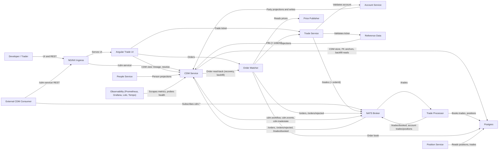

# CDM Lifecycle, Party and Security Model

State 009 order-management runtime with FINOS CDM 7.8.0 underneath: cdm-service is the system of record for parties, persons and securities and mirrors every order and trade event into lineage-linked CDM objects; existing services serve their simple shapes as projections with an optional cdmRef.

- Generated from: `system/architecture.model.json`
- Canonical flows: `system/end-to-end-flows.md`

## Architecture Diagram

## Node Catalog

| Node | Kind | Label | Notes |
| --- | --- | --- | --- |
| `developer` | actor | Developer / Trader | Uses the TraderX UI (including the CDM view) and REST APIs through the ingress. |
| `cdm_consumer` | actor | External CDM Consumer | Any client reading CDM over /cdm-service/ REST or the cdm.* NATS subjects. |
| `ingress` | service | NGINX Ingress | Single origin on :8080; adds the /cdm-service/ route in this state. |
| `trade_ui` | service | Angular Trade UI | Trade and order tickets, blotters with CDM links, admin tab and the new CDM view (/cdm). |
| `account_service` | service | Account Service | Accounts and account users as projections of CDM Party objects (+ cdmRef); writes go through cdm-service. |
| `people_service` | service | People Service | Person directory as a projection of CDM NaturalPerson objects (+ cdmRef). |
| `reference_data` | service | Reference Data | Stocks as projections of CDM Security objects (+ cdmRef). |
| `trade_service` | service | Trade Service | Validates trades against account/reference data and passes the optional orderId to /trades. |
| `order_matcher` | service | Order Matcher | Order lifecycle (+ filledQuantity, canceledQuantity, cdmRef), fills with orderId, rejected requests on /orders/rejected, partial force-fill. |
| `trade_processor` | service | Trade Processor | Books trades and positions; publishes each committed trade on /trades/booked. |
| `position_service` | service | Position Service | Positions (+ cdmRef) and trades from the shared database. |
| `cdm_service` | service | CDM Service | Java 21 / Spring Boot / cdm-java 7.8.0. Party, person and security masters; lifecycle adapter (NATS -> WorkflowStep, BusinessEvent, TradeState); CDM validation; lineage, resolve, positions and diagnostics APIs; publishes cdm.* subjects. |
| `nats` | service | NATS Broker | Pricing, trade, position and order subjects plus /trades/booked, /orders/rejected and cdm.workflow, cdm.events, cdm.tradestate. |
| `postgres` | datastore | Postgres | Shared database: 009 tables (trades.orderid, orderbook.canceledquantity added) plus cdm_documents, cdm_pending_trades, cdm_pending_cancels, cdm_lifecycle_failures. |
| `price_publisher` | service | Price Publisher | Market prices for the matcher and UI (unchanged). |
| `observability` | boundary | Observability (Prometheus, Grafana, Loki, Tempo) | Inherited LGTM stack; Prometheus scrapes cdm-service and blackbox probes its /health. |

