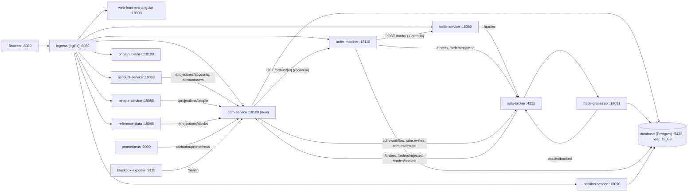

# Runtime Topology: 017-cdm-lifecycle-mapping

Parent state: `009-order-management-matcher`

Docker Compose project `traderx-state-017` (`generated/code/target-generated/cdm-lifecycle-mapping/docker-compose.yml`).
The 009 topology is unchanged except for one new service, `cdm-service`, and the dependencies on it.

## Entrypoints

- `http://localhost:8080/`: TraderX UI, including the new CDM view at `/cdm`.
- `http://localhost:8080/cdm-service/`: cdm-service REST (CDM objects, lineage, resolve, positions,
  diagnostics, projections, `/health`). Direct port `18120`.
- `http://localhost:8080/api/docs`: API explorer, now including the cdm-service contract and the
  `cdm.*`, `/trades/booked` and `/orders/rejected` subjects in the pub/sub inspector.
- All 009 entrypoints are unchanged (Grafana `:3001` and `/grafana/`, Prometheus `:9090`, NATS
  `:4222`/`:8222`/WebSocket `:8081`).

## Components

| Component | Change in 017 |
|---|---|
| `cdm-service` (new) | Java 21, Spring Boot 4.0.8, `cdm-java` 7.8.0. Image built from `cdm-service/Dockerfile.compose` (`eclipse-temurin:21-jre`). Owns the CDM store in the shared Postgres. Single instance. |
| `account-service`, `people-service`, `reference-data` | Read and write their data through cdm-service (`CDM_SERVICE_URL=http://cdm-service:18120`). |
| `order-matcher` | Seeds only `NEW` demo orders (`ORDER_MATCHER_SEED_STATUSES=NEW`); publishes `/orders/rejected`; sends `orderId` with fills. |
| `trade-service`, `trade-processor` | Pass `orderId` through; trade-processor publishes `/trades/booked`. |
| `position-service` | Adds `cdmRef` to positions. |
| `web-front-end-angular` | New CDM view; base href `/`. |
| `ingress` | New `location /cdm-service/` (added by `pipeline/render-state-017-cdm-lifecycle-mapping.sh`). |
| `prometheus`, `blackbox-exporter` | Scrape `cdm-service:18120/actuator/prometheus` in the `traderx-spring-boot-actuator` job and probe `http://cdm-service:18120/health` (render script). |
| `database` | Schema adds `cdm_documents`, `cdm_pending_trades`, `cdm_pending_cancels`, `cdm_lifecycle_failures`, `trades.orderid`, `orderbook.canceledquantity`. Volume `traderx-state-017_postgres_state_017_data`. |

## Networking

- One compose network; services reach each other by compose service name.
- cdm-service environment: `DATABASE_PG_HOST=database`, `NATS_BROKER_HOST=nats-broker`,
  `ORDER_MATCHER_URL=http://order-matcher:18110`, `CDM_LIFECYCLE_NATS_ENABLED=true`,
  `CDM_LIFECYCLE_BACKFILL_ENABLED=true`, `TZ=UTC`.
- Host ports are the same as state 009 plus `18120`, so 009 and 017 cannot run at the same time; the
  start script refuses to start while `traderx-state-009` is running.

## Startup / Health Order

1. `database` (healthy: `pg_isready`) and `nats-broker`.
2. `cdm-service` starts after the database is healthy. It seeds the security master (509 securities)
   and the party master (009 accounts and users, `people.json` persons, venue party), retrying with
   backoff until the seed is complete. `/health` answers 503 `starting` until both masters are ready,
   then 200 `ok`; the compose healthcheck uses it (start period 30 s, 60 retries at 5 s).
3. `account-service`, `people-service` and `reference-data` start once `cdm-service` is healthy.
4. The rest of the 009 services start as before (trade-service, trade-processor, position-service,
   order-matcher, price-publisher, UI, ingress, observability).
5. Once the masters are ready, cdm-service subscribes to `/orders`, `/orders/rejected` and
   `/trades/booked` (and again after any NATS reconnect) and runs its startup backfill: seed trades as
   direct trades, open matcher orders as proposals (retrying until the matcher answers), and fills
   booked while it was down. Progress is reported at `/cdm/validation-summary` (`backfill.complete`).
6. The start script waits for cdm-service on `18120` and through the ingress at `/cdm-service/health`.

`./scripts/status-state-017-cdm-lifecycle-mapping-generated.sh` reports cdm-service health, its ingress
route and its metrics alongside the 009 rows.
